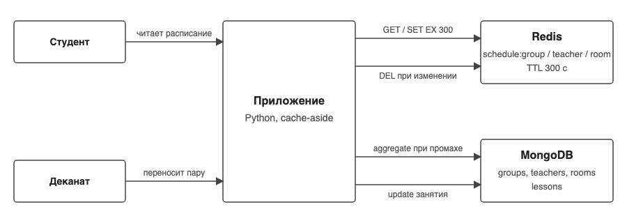

# Кэш расписания университета (Redis + MongoDB)

СРО по дисциплине «Проектирование и применение NoSQL-технологий», вариант 11.

Задача по методичке: TTL и удаление кэша после изменения расписания, анализ stale data.

- Отчет: [docs/report.pdf](docs/report.pdf)
- Презентация: [docs/presentation.pdf](docs/presentation.pdf)
- ADR: [docs/ADR.md](docs/ADR.md)

## Идея

Расписание читают постоянно (студенты открывают свою группу по много раз в день), а меняют редко (деканат переносит пару). Поэтому основное хранилище - MongoDB, а готовое расписание группы, преподавателя и аудитории лежит в Redis как JSON с TTL. Когда пару переносят, приложение удаляет из Redis все ключи, в которые эта пара входила. Это cache-aside.



## Требования

Функциональные:
1. Показать расписание группы на неделю и на конкретный день
2. Показать расписание преподавателя
3. Показать занятость аудитории
4. Добавить, перенести (аудитория, день, время) и удалить занятие
5. После изменения занятия студент при следующем запросе видит новое расписание
6. Найти свободные аудитории в заданный день и время
7. Посчитать нагрузку преподавателей и найти конфликты аудиторий
8. Показать статистику кэша: попадания, промахи, количество инвалидаций

Нефункциональные:
1. Повторное чтение расписания из кэша быстрее 1 мс (в Mongo это 3-20 мс со сборкой из 4 коллекций)
2. Окно устаревших данных после переноса пары - ноль при штатной инвалидации, не больше TTL (300 с) в худшем случае
3. Если Redis недоступен или ключ истек, данные всегда можно собрать из Mongo, кэш ничего не хранит эксклюзивно
4. Запуск с нуля одной командой docker compose + скрипт заполнения, никаких секретов в репозитории

## Access patterns

| # | Запрос | Кто | Частота | Приоритет | Где выполняется | Ожидаемый результат |
|---|---|---|---|---|---|---|
| AP1 | расписание группы на неделю | студент | очень часто | высокий | Redis, при промахе Mongo | список занятий группы, отсортирован по дню и времени |
| AP2 | расписание группы на день | студент | очень часто | высокий | фильтр по недельному кэшу | занятия одного дня |
| AP3 | расписание преподавателя | преподаватель | часто | высокий | Redis / Mongo | все его пары по всем группам |
| AP4 | занятость аудитории | деканат | средне | средний | Redis / Mongo | все пары в аудитории |
| AP5 | перенести пару | деканат | редко | высокий | Mongo + DEL ключей | расписание группы, преподавателя, старой и новой аудитории обновлено |
| AP6 | добавить / удалить пару | деканат | редко | средний | Mongo + DEL ключей | то же |
| AP7 | свободные аудитории в слот | деканат | редко | средний | Mongo, $lookup | аудитории без занятий в этот день и время |
| AP8 | нагрузка преподавателей | кафедра | раз в семестр | низкий | Mongo, $group | пары и часы в неделю по каждому |
| AP9 | конфликты аудиторий | деканат | после правок | средний | Mongo, $group | пары, где две группы в одной аудитории одновременно |
| AP10 | поиск по названию предмета | студент | редко | низкий | Mongo, regex | занятия по предмету |

AP1-AP4 читают, их и кэшируем. AP5-AP6 пишут и сбрасывают кэш. AP7-AP10 аналитика, в кэше не нужна.

## Модель данных

MongoDB, база `university`, 4 коллекции:

```
groups   { code: "IS-31", course: 3, faculty: "Информационные системы", students: 24 }
teachers { teacher_id: 2, name: "Нурланова Д.К.", department: "Информационные системы" }
rooms    { room: "B-201", building: "B", capacity: 25, type: "lab" }
lessons  { lesson_id: "L001", group_code: "IS-31", subject: "NoSQL технологии", teacher_id: 2,
           room: "B-202", weekday: 4, start: "14:30", end: "15:50", kind: "лаб" }
```

lessons ссылается на остальные по group_code, teacher_id, room (referencing, а не embedding): преподаватель или аудитория переименовываются в одном месте, а расписание собирается через $lookup при промахе кэша. Индексы: уникальные по lesson_id, code, teacher_id, room и составные `(group_code, weekday, start)`, `(teacher_id, weekday)`, `(room, weekday, start)` - по одному на каждый кэшируемый запрос.

Redis:

| Ключ | Значение | TTL |
|---|---|---|
| `schedule:group:IS-31` | JSON расписания группы на неделю | 300 с |
| `schedule:teacher:2` | JSON расписания преподавателя | 300 с |
| `schedule:room:B-201` | JSON занятости аудитории | 300 с |
| `stats:hits`, `stats:misses`, `stats:invalidations` | счетчики | нет |

В JSON уже подставлены имя преподавателя и корпус, чтобы при попадании в кэш вообще не ходить в Mongo.

Инвалидация: при изменении занятия берем старый и новый документ и удаляем ключи группы, преподавателя и аудитории из обоих. Перенос L001 из B-202 в B-201 сбрасывает 4 ключа: группу, преподавателя, B-202 и B-201.

## Запуск

Нужны Docker и Python 3.9+.

```
cp .env.example .env
docker compose up -d
python3 -m venv .venv && source .venv/bin/activate
pip install -r requirements.txt
python scripts/seed.py
python scripts/demo_queries.py
python scripts/stale_analysis.py
pytest -v
```

Тесты ходят в отдельную базу `university_test` и Redis db 1, демо-данные не трогают.

Структура:
```
src/schedule_cache/   config, db (подключения), repository (Mongo), cache (Redis), service (cache-aside + инвалидация)
scripts/seed.py       заполнение из data/*.json
scripts/schedule.py   CLI: group, teacher, room, move, add, remove, stats, keys
scripts/demo_queries.py   8 запросов + статистика
scripts/stale_analysis.py эксперимент со stale data
tests/                14 тестов pytest
data/                 6 групп, 8 преподавателей, 7 аудиторий, 40 занятий
docs/                 ADR, схема, отчет, презентация
```

## Запросы

Полный вывод в отчете, здесь коротко. `python scripts/demo_queries.py`:

Q1. Расписание IS-31 два раза подряд: первый раз `mongo, 8.44 ms`, второй `cache, 0.51 ms, ttl 300 с`.

Q2. IS-31 на вторник: `cache, 0.49 ms`, 2 занятия - день фильтруется из недельного ключа, отдельного ключа нет.

Q3. Преподаватель 2 - 5 пар NoSQL у четырех групп. Q4. Аудитория B-201 - 7 пар.

Q5. Свободные аудитории в четверг 14:30 - 5 из 7 (заняты A-101 и B-202). $lookup с pipeline по rooms.

Q6. Нагрузка: Сериков 7 пар / 9.3 ч, Жумабеков и Омарова по 6, Касымова 2. $group по teacher_id, потом $lookup имени.

Q7. Конфликты: `B-202 Чт 14:30: группы IS-31 и IT-41, занятия L001, L040`. Это пересечение заложено в данных специально.

Q8. Перенос L001 из B-202 в B-201:
```
ключи в кэше до:    schedule:group:IS-31, schedule:room:B-201, schedule:teacher:2
сброшены:           schedule:group:IS-31, schedule:teacher:2, schedule:room:B-202, schedule:room:B-201
ключи в кэше после: []
стало: IS-31 Чт 14:30 B-201  [источник mongo]
```

Q9. Поиск по "nosql" - 5 занятий. Q10. Статистика: hits 2, misses 4, invalidations 8.

CLI для защиты:
```
python scripts/schedule.py group IS-32            # mongo
python scripts/schedule.py group IS-32 --day 2    # cache
python scripts/schedule.py move L009 --room B-202 # сбросит 4 ключа
python scripts/schedule.py keys
python scripts/schedule.py stats
```

## Анализ stale data

`python scripts/stale_analysis.py`, занятие L002 группы IS-31:

| Сценарий | Сколько кэш отдавал старую аудиторию |
|---|---|
| 1. Только TTL=5 с, ключ не удаляем | 4.89 с (до истечения TTL) |
| 2. TTL=300 с + DEL после изменения | 0.00 с |
| 3. Гонка: читатель прочитал из Mongo до записи, положил в кэш после DEL | 4.88 с, спас только TTL=5 с |
| 4. 300 случайных чтений по 6 группам | hit ratio 0.98, mongo 3.69 мс, redis 0.34 мс |

Выводы: без удаления ключа студент видит старую аудиторию до TTL, для расписания это недопустимо (при TTL 300 с - до пяти минут). С удалением окно нулевое. Но гонка в сценарии 3 возможна, если два запроса приходят одновременно с переносом, и тогда старые данные живут до TTL. Поэтому TTL оставлен коротким (5 минут), он работает как страховка. Полностью убрать гонку можно повторным DEL через секунду после записи (delayed double delete) или версией расписания в ключе, это описано в отчете как ограничение.

## Тесты

14 тестов, `pytest -v`:
- repository: счетчики seed, CRUD занятия, сортировка и $lookup в расписании, свободные аудитории не содержат занятую, конфликт находится
- cache: miss потом hit и счетчики, у ключа есть TTL, ключ с TTL=1 исчезает и следующий запрос идет в Mongo, данные из кэша равны данным из Mongo
- invalidation: перенос сбрасывает ключи и старой, и новой аудитории; чтение после переноса свежее; без инвалидации кэш отдает старую аудиторию (stale); add и remove тоже сбрасывают; изменение несуществующего занятия - ошибка

## Ограничения

- Инвалидацию делает приложение. Если поменять lessons напрямую в Mongo (например через mongosh), кэш узнает только по TTL
- Гонка чтения и записи (сценарий 3) не закрыта, окно до TTL
- Один Redis и один Mongo без репликации, это прототип
- Недели числитель/знаменатель и семестры не моделировал, расписание одно на все недели
